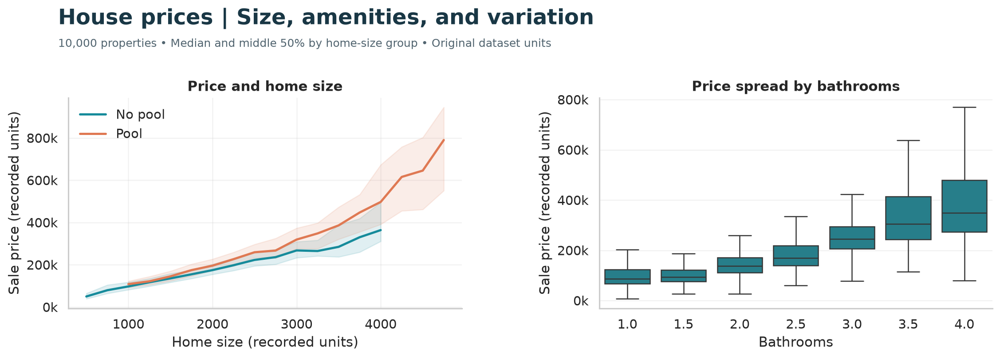
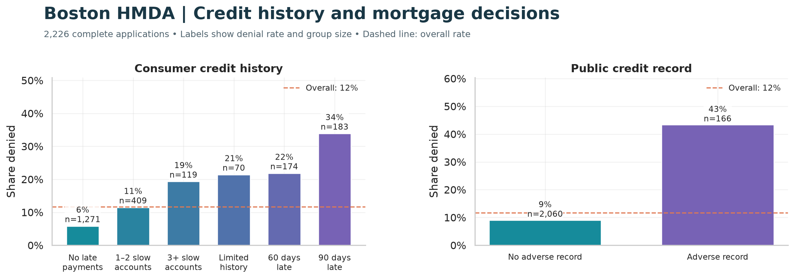
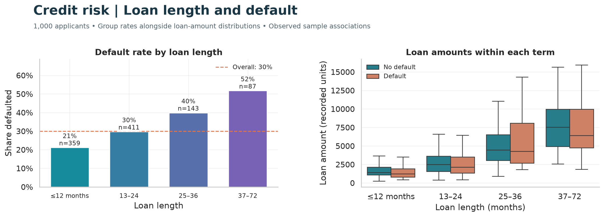
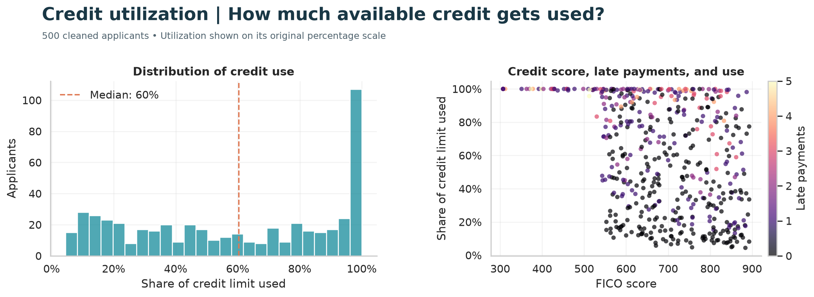
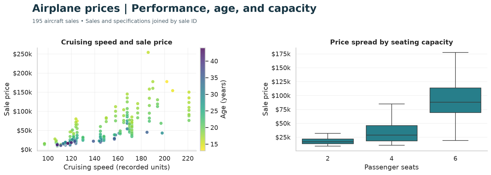

# Basic ML

Five projects exploring what tabular data can tell us about prices, lending decisions, default, and credit use. The work starts with the data: its distributions, missing values, relationships, and the choices needed to turn it into a modeling problem.

The notebooks walk through those questions visually. The Python modules handle data preparation, model tuning, and evaluation, comparing linear models, trees, random forests, and boosting with scikit-learn, XGBoost, and LightGBM.

## A look at the data

### House prices

Compare how sale prices vary with home size, pool availability, and bathrooms. The shaded bands show the middle 50% within size groups; size groups with fewer than 10 properties are omitted.

[](notebooks/_prices.ipynb)

[Open the house-price notebook →](notebooks/_prices.ipynb)

### Boston HMDA

Read denial rates alongside group sizes and the overall rate. Credit-history categories are labeled directly, so the comparison does not depend on remembering survey codes.

[](notebooks/_hmda.ipynb)

[Open the HMDA notebook →](notebooks/_hmda.ipynb)

### Credit risk

Default rates rise from 21% to 52% across these loan-length groups. The second plot shows loan-amount distributions within each term, split by default outcome.

[](notebooks/_credit.ipynb)

[Open the credit-risk notebook →](notebooks/_credit.ipynb)

### Credit utilization

See the distribution of credit use, then compare utilization with FICO scores and late payments. Percentages show the share of available credit used, before the model's log-odds transformation.

[](notebooks/_utilization.ipynb)

[Open the utilization notebook →](notebooks/_utilization.ipynb)

### Airplane prices

Explore sale prices against cruising speed and age, then compare the price spread across seating capacities.

[](notebooks/_airplane.ipynb)

[Open the airplane notebook →](notebooks/_airplane.ipynb)

Figures redraw analyses from all five notebooks using the project data loaders. Boxplots hide outlier markers for readability. These are sample associations, not causal effects.

## Explore the projects

| Project | What you'll find | Notebook | Code |
|---|---|---|---|
| House prices | Property size, age, amenities, and location as predictors of sale price. | [Explore](notebooks/_prices.ipynb) | [Source](src/prices/) |
| Boston HMDA | Mortgage approvals and denials, with analysis of credit history, income, assets, and PMI outcomes. | [Explore](notebooks/_hmda.ipynb) | [Source](src/hmda/) |
| Credit risk | Applicant finances and credit history used to classify default. | [Explore](notebooks/_credit.ipynb) | [Source](src/credit/) |
| Credit utilization | Application, credit-bureau, and neighborhood data joined to model how much available credit applicants use. | [Explore](notebooks/_utilization.ipynb) | [Source](src/utilization/) |
| Airplane prices | Sales, specifications, and performance records joined to predict aircraft prices. | [Explore](notebooks/_airplane.ipynb) | [Source](src/airplane/) |

Start with a notebook to see the data and analysis, then follow its source folder to see how the models are trained. The [HMDA project README](src/hmda/README.md) goes further into feature definitions, results, and interpretation.

## Inside the code

Each project follows the same small module layout:

- `config.py` defines data sources, predictors, the target, and split settings.
- `data_ingestion.py` loads the data; cleaning lives here or in `preprocessing.py`.
- `model_registry.py` holds the estimators and hyperparameter search grids.
- `main.py` runs the search and evaluates on a held-out test set using `metrics.py`.

Regression searches select models by cross-validation mean squared error; classification searches use ROC AUC. Credit utilization is modeled as log-odds, so its regression errors are on that transformed scale.

## Setup

From the repository root:

```bash
python3 -m venv venv
source venv/bin/activate
pip install -r requirements.txt
```

House prices requires `data/dataset.csv`; HMDA requires `data/hmda.txt`. The other projects load CSVs from URLs defined in their configs.

For notebooks:

```bash
pip install jupyter ipykernel matplotlib seaborn
```

## Run

```bash
python -m src.prices.main
python -m src.hmda.main
python -m src.credit.main
python -m src.utilization.main
python -m src.airplane.main
```

Run one command for the project you want. Each prints its model-search and evaluation results.

## Tests

```bash
pip install pytest
python -m pytest
```

## Notes

The house-price training script scales predictors before cross-validation, so validation folds share scaling statistics. HMDA includes underwriting fields that may only be available during the lending decision; its results do not establish performance at initial application.

## License

[MIT](LICENSE)
