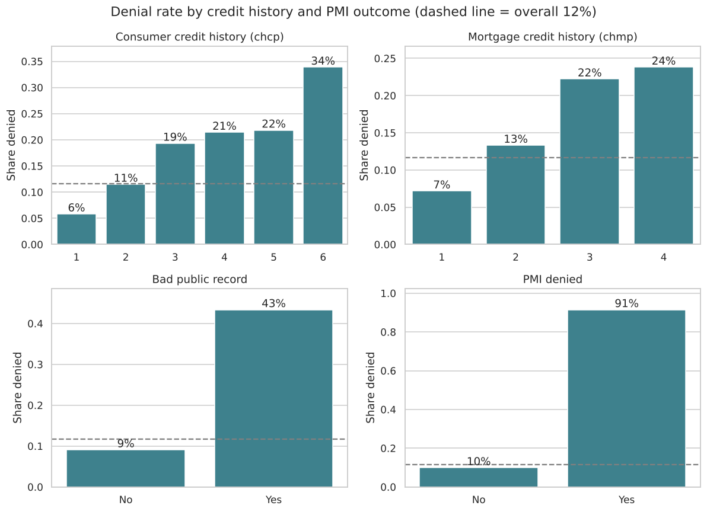

# Boston HMDA: Mortgage Denial Prediction

A tabular classification project built around a simple question: **which recorded application characteristics help distinguish denied mortgage applications from approved ones?**

The project combines a documented feature schema, exploratory analysis, and cross-validated comparisons of logistic regression, decision trees, random forests, and XGBoost. It uses the **1990 Boston HMDA dataset** and keeps the original numeric and coded features—no log transforms or one-hot encoding.

## Results

The current feature set (32 predictors) gives these mean cross-validation ROC AUC scores on the training partition:

| Model | Mean CV ROC AUC |
|---|---:|
| Logistic regression | 0.9058 |
| Decision tree | 0.8613 |
| Random forest | 0.9110 |
| **XGBoost** | **0.9195** |

The CV-selected XGBoost model, scored on the held-out test set:

| Holdout metric | With `credit_meets_policy` | Without `credit_meets_policy` |
|---|---:|---:|
| ROC AUC | **0.9495** | **0.9064** |
| Accuracy | 93.72% | 92.38% |
| Macro F1 | 0.8303 | 0.7555 |

`credit_meets_policy` (`s40`) is the lender's own judgement of whether the applicant's credit history meets its approval guidelines, so it sits close to the decision itself. It is the single most important feature in the main model, accounting for about half of XGBoost's feature importance. The second column shows the same model and settings with that one feature left out: the remaining applicant features still reach **0.91 ROC AUC**, and the model then leans most on public records, consumer credit history, unverifiable information, PMI denial, and debt-to-income.

The "without" column is a comparison run only; the configured feature set includes `credit_meets_policy`.

These are measured results from the current seed-42 split and configured search grids. The feature set was chosen through exploratory work on this same dataset, so these numbers are **not an independent final validation**.

## What the data shows



Observed denial rates climb steadily with worse consumer and mortgage credit history, and jump sharply for applicants with a bad public record or a denied PMI application. The dashed line marks the overall denial rate of about 12%. These plots describe the cleaned historical sample; they are not adjusted causal estimates.

## Dataset and target

The local `data/hmda.txt` file contains **2,380 applications and 62 raw columns**. The analysis selects relevant fields rather than passing the full survey record into the model.

The raw outcome is `s7`, the type of action taken:

| Raw value | Meaning | `denied` | Applications |
|---|---|---:|---:|
| `1` | Loan originated | 0 | 2,025 |
| `2` | Approved but not accepted | 0 | 70 |
| `3` | Application denied | 1 | 285 |

After cleaning, the sample has **2,226 applications** (1,967 approved, 259 denied): 1,780 training rows and 446 test rows. The positive class means **denied**, about 12% of applications.

Definitions follow the [Boston HMDA codebook](https://www.maxmatsuda.com/ONU/IBEC430/Excel/Chapter%2011/Boston%20Mortgage%20Application%20Data/hmda.pdf), which identifies these data as the 1990 Boston mortgage application sample. The underlying study is Munnell, Tootell, Browne, and McEneaney, [*Mortgage Lending in Boston: Interpreting HMDA Data*](https://www.jstor.org/stable/2118254), American Economic Review (1996).

## Features

The model uses 32 predictors, all taken directly from raw columns. `s7` is used only to construct the target.

| Predictor | Raw source | Meaning / encoding |
|---|---|---|
| `loan_amount` | `s6` | Loan amount, thousands |
| `appraised_value` | `s50` | Appraised value, thousands |
| `property_type` | `s51` | `1 = condominium`, `2 = single family` |
| `county` | `s11` | `1 = Suffolk`, `0 = other` |
| `sex` | `s15` | `1 = male`, `0 = female` (not provided → missing) |
| `applicant_income` | `s17` | Applicant income, thousands per year |
| `expense_to_income` | `s45` | Housing expense / income, bank's calculation, % |
| `debt_to_income` | `s46` | Total obligations / income, bank's calculation, % |
| `fixed_rate` | `s47` | `1 = fixed`, `0 = adjustable` (not available → missing) |
| `net_worth` | `netw` | Assets minus liabilities, thousands |
| `liquid_assets` | `s35` | Liquid assets, thousands |
| `chcp` | `s43` | Credit history, consumer payments, codes 1–6 |
| `chmp` | `s42` | Credit history, mortgage payments, codes 1–4 |
| `public_record_history` | `s44` | `1 = bankruptcy, charge-offs or collections`, `0 = none` |
| `industry_unemployment_rate` | `uria` | Unemployment rate in the applicant's industry |
| `rtdum` | `rtdum` | Neighbourhood minority share: `1 = above 30%` |
| `bd` | `bd` | Boarded-up buildings above area median (1/0) |
| `median_tract_income` | `mi` | Neighbourhood median income above area median (1/0) |
| `tract_vacancy` | `vr` | Vacant homes above area median (1/0) |
| `tract_value_change` | `chval` | % change in neighbourhood home values, 1980–1990 |
| `self_employed` | `s27a` | `1 = yes`, `0 = no` |
| `pmi_denied` | `s53` | `1 = insurance sought and denied`; `0 = approved, not sought, or unavailable` |
| `race` | `s13` | Raw `3 = Black` → 1; raw `5 = White` → 0 |
| `pmi_sought` | `s52` | `1 = yes`; `0 = no or unavailable` |
| `credit_meets_policy` | `s40` | Credit history meets the lender's approval guidelines |
| `unverifiable_information` | `s56` | Some application information is unverifiable |
| `marital_status` | `s23a` | `M = married` → 0, `U = unmarried` → 1, `S = separated` → 2 |
| `dependents` | `s24a` | Number of dependents |
| `years_employed` | `s25a` | Years in line of work |
| `years_on_job` | `s26a` | Years on current job |
| `housing_expense` | `s32` | Proposed monthly housing expense, dollars |
| `education` | `school` | Years of education |

Mortgage-history code `2` means no payment history, and consumer-history code `4` means insufficient history. These are retained as codes, so a linear model treats their numeric spacing as meaningful; that is a modeling choice, not a claim that all code steps represent equal changes in credit quality.

## Data preparation

- Rename the survey codes using the dictionary in `config.py` and keep only the configured features and target.
- Read `999999.4`, the dataset's missing-value code for numbers, as missing when the file is loaded.
- Map coded columns with `CODE_MAPS` in `data_ingestion.py`. Codes that are not in a map (such as undocumented `s40 = 666`, `sex = 3` or `fixed_rate = 3`) become missing.
- Drop rows with any missing value, which keeps 2,226 of 2,380 applications.
- Median-impute and standardize features inside each training fold. The target remains binary and is never scaled.

## Evaluation

1. Make one stratified 80/20 train/test split with `random_state=42`, so both partitions keep the same denial rate.
2. Run `GridSearchCV` on the training partition using four-fold ROC AUC scoring. For these classifiers, the integer `cv=4` uses stratified folds without shuffling.
3. Select the highest mean CV AUC.
4. Predict probabilities and classes on the held-out partition; report ROC AUC, accuracy, and macro F1.

The full preprocessing pipeline stays inside cross-validation. No test-set statistics are used to fit the imputer or scaler.

The selected XGBoost settings were 200 estimators, depth 3, learning rate 0.05, minimum child weight 3, and L2 regularization 10. All tested grids are defined in `model_registry.py`.

## Run

From the **Basic-ML repository root**, with Python and a virtual environment available:

```bash
python3 -m venv venv
venv/bin/python -m pip install -r requirements.txt
venv/bin/python -m src.hmda.main
```

To train the selected XGBoost model on its own and plot its feature importance:

```bash
venv/bin/python -m src.hmda.feature_importance
```

The local `data/hmda.txt` file must be present. Dependencies and versions are specified in the repository's `requirements.txt`.

The training command prints each model's CV AUC, the selected model and parameters, and its holdout metrics. It does not currently save fitted models or metrics artifacts.

## Explore the data

The EDA notebook is `notebooks/_hmda.ipynb`. It covers the cleaned data, summary statistics, outcome balance, denial rates by credit history, public records and PMI outcome, liquid assets, applicant income, and dependents by marital status. It contains **EDA only**; training lives in the Python modules.

## Source layout

```text
Basic-ML/
├── data/hmda.txt
├── notebooks/_hmda.ipynb
└── src/hmda/
    ├── config.py              # Feature schema, target, split and CV settings
    ├── data_ingestion.py      # Loading, code mappings and cleaning
    ├── model_registry.py      # Estimators and parameter grids
    ├── metrics.py             # ROC AUC, accuracy and macro F1
    ├── main.py                # Search, selection and holdout evaluation
    └── feature_importance.py  # Selected XGBoost model and feature importance plot
```

## Interpretation and limitations

**Feature availability matters.** Policy compliance, unverifiable information, and PMI outcomes may be recorded during underwriting. The scores describe classification using those recorded fields; they do not establish an early-stage application forecast. The results table shows how much `credit_meets_policy` alone contributes.

**Class imbalance matters.** About 88% of applications were approved, so a model that always predicts "approved" is already about 88% accurate. Review ROC AUC and macro F1 rather than accuracy alone.

**Historical association is not causation.** Including race supports examination of this historical dataset; predictive performance is not evidence of causal effects, fairness, or suitability for lending decisions. When `credit_meets_policy` is removed, `race` becomes one of the more important features, which is the pattern the original Boston Fed study examined. There is no fairness audit in this project.

**Generalization remains untested.** This is one historical metropolitan sample with one random holdout. Performance across institutions, other populations, or later periods requires separate validation.

## Checks

The ingestion schema, code mappings, row counts, and full training command were checked during development. There is not yet a dedicated HMDA automated test suite.
